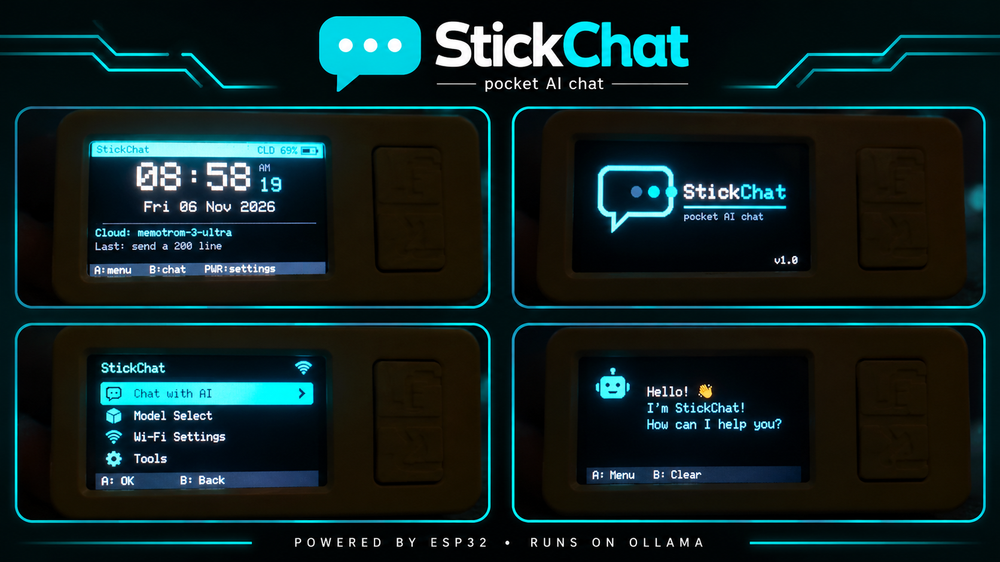

<p align="center">
  
</p>

<h1 align="center">StickChat</h1>
<p align="center"><strong>A tiny Wi-Fi AI chat client for the M5StickC Plus2, powered by Ollama.</strong></p>

<p align="center">
  
</p>


**A tiny Wi-Fi AI chat client for the M5StickC Plus2, powered by Ollama.**

StickChat turns the M5StickC Plus2 into a pocket-sized interface for chatting with an Ollama model running on your laptop or with a model available through the Ollama cloud API. It uses the device's 240 × 135 display and three-button controls, with a compact menu-driven interface.

> Built by Prince Sahani. The interface is inspired by the menu style of ESP32 Marauder.
## Features

### AI chat

- **On-device chat interface** — type prompts with the three-button on-screen keyboard (three layers: lowercase, uppercase, symbols).
- **Local Ollama support** — connect to an Ollama server on your laptop or another computer on your Wi-Fi.
- **Ollama Cloud support** — optionally connect to `ollama.com` with an API key.
- **Local/cloud fallback** — use the preferred endpoint and fall back to the other when it is unreachable.
- **Streaming responses** — reply text appears as it is generated; hold **A** to stop a reply early.
- **Model browser** — list models from the laptop or from ollama.com and pick one on the device.
- **Free-tier model scan** — test cloud models with a tiny request, hide the ones your plan blocks, and cache the results (rate-limit aware, see below).
- **Conversation context** — a rolling history of the last 8 messages / ~3000 characters.
- **Prompt LIST key** — re-send any of your last 10 prompts or start from a preset such as "Summarize:" or "Translate to Hindi:".
- **Reply style** — Short (~40 words), Normal (~80) or Detailed (~200), and Auto / English / Hinglish (Hindi in English letters) language.

### Home screen, clock and time

- **Home screen** — big clock with seconds, date, the model that will answer, your last prompt, and live chips for a running timer (`T`), stopwatch (`SW`), snooze (`Z`) and alarm (`AL`).
- **Status header** — link mode (`LAN` / `CLD` / `off`) and a battery icon with percentage (red at 15% or below).
- **NTP time sync** — automatic, with retries until it succeeds (3 time servers).
- **RTC persistence** — the Plus2's clock chip keeps the time across deep sleep and power-off.
- **Timezone and 12/24-hour format** — 14 timezones, India (UTC+5:30) by default.

### Timer, stopwatch and alarm (Tools menu)

- **Countdown timer** — presets (1–60 min) or a custom 1–600 minutes, with +1 minute while running.
- **Stopwatch** — start/stop, reset, and up to 20 laps.
- **Daily alarm** — pick the time with a spinner; flashing screen and beeps; **snooze 5 minutes** (its own countdown, independent of the timer).
- **Alerts keep working** while a reply is streaming, while connecting to Wi-Fi and while scanning models.

### Look, sleep and power

- **Original logo** drawn in code (no image data) — plays on boot, when the screen sleeps and when it wakes (2 seconds each; easy to change, see below).
- **Screen-off sleep** (15 s – 2 min) and **deep sleep** (off / 2 / 5 / 10 min) with button-A wake.
- **Deep sleep that respects alarms** — timers, snooze, alarm and a running stopwatch survive deep sleep; the chip wakes itself about 12 seconds before the next event.
- **Low-battery warning** — beeps and a message at 15% (every 5 min) and 5% (every 2 min).
- **Frequency scaling** — runs at 80 MHz and speeds up to 160 MHz only for HTTPS work.

### Security and reliability

- **Verified HTTPS** — the root CA for ollama.com is pinned and checked (needs a valid clock, which the stick syncs for you).
- **Settings validation** — corrupt or out-of-range saved values are reset to safe defaults at boot.
- **Rate-limit handling** — HTTP 429 pauses model scanning for 10 minutes; models that time out are skipped for 30 minutes.
- **Authentication errors are told apart from plan restrictions** — "API key rejected" is not the same as "model not in the free tier".
- **Memory guards** — conversation size cap, tail-only streaming redraw, free-heap check before each cloud request, and heap numbers on the About screen.

## Hardware and software

### Hardware

- M5Stack **M5StickC Plus2**
- USB data cable
- A Wi-Fi network (2.4 GHz)
- A laptop or computer running Ollama for local mode, or an Ollama Cloud API key for cloud mode

### Build environment

- PlatformIO Core / PlatformIO IDE
- Espressif32 Arduino framework
- Python 3 and `openssl` (only for the one-time certificate step)
- Libraries declared in `platformio.ini`: `M5Unified`, `ArduinoJson` 7

The project environment is `m5stickc-plus2` (8 MB flash layout, needed for TLS).

## How it works

1. The StickC joins the configured Wi-Fi network.
2. **Local mode:** it sends `POST http://HOST:PORT/api/chat` to your Ollama server.
3. **Cloud mode:** it sends `POST https://ollama.com/api/chat` with a bearer API key over verified TLS.
4. The reply is streamed back line by line and drawn on the display as it arrives.

Model lists come from `/api/tags` on the local server or from `https://ollama.com/api/tags`.

## Getting started (tutorial)

### 1. Clone the repository

```bash
git clone https://github.com/Prince-Sahani137/M5StickChat.git
cd M5StickChat
```

### 2. Install PlatformIO on Linux

```bash
sudo apt update
sudo apt install -y python3 python3-venv python3-pip git
python3 -m venv ~/.venvs/platformio
source ~/.venvs/platformio/bin/activate
pip install -U platformio
pio --version
```

In a new terminal, activate it again with `source ~/.venvs/platformio/bin/activate`.

### 3. Configure the device

Open `src/config.h` and set the first-boot defaults:

```cpp
#define DEF_SSID  "YOUR_WIFI_SSID"
#define DEF_PASS  "YOUR_WIFI_PASSWORD"

#define DEF_HOST  "YOUR_HOST_IP"
#define DEF_PORT  11434
#define DEF_MODEL "YOUR_LOCAL_OLLAMA_MODEL"

#define DEF_API_KEY "YOUR_OLLAMA_API_KEY"
#define DEF_CLOUD_MODEL "gpt-oss:20b"
#define DEF_USE_CLOUD 1
```

| Setting | Purpose |
|---|---|
| `DEF_SSID` / `DEF_PASS` | Wi-Fi name and password |
| `DEF_HOST` | LAN IP address of the computer running Ollama |
| `DEF_PORT` | Ollama port, normally `11434` |
| `DEF_MODEL` | Exact local model name from `ollama list` |
| `DEF_API_KEY` | Ollama Cloud API key (leave a placeholder if you will not use cloud) |
| `DEF_CLOUD_MODEL` | Cloud model name — **with a colon, no `-cloud` suffix** (for example `gpt-oss:20b`) |
| `DEF_USE_CLOUD` | `1` enables cloud, `0` disables it |

`config.h` holds **first-boot defaults** only. After a value has been saved to flash (NVS), the saved value wins. Change settings later in the device's **Settings** menu, or use **Settings → Reset all settings** to reload the compiled defaults.

> **Keep secrets out of git.** Do not commit your real Wi-Fi password or API key. Either keep placeholders in `config.h` and type the real values in the device's Settings, or run `git update-index --skip-worktree src/config.h` after editing it locally.

The old `SYSTEM_PROMPT` macro is no longer used: the system prompt is built from **Settings → Reply style**.

### 4. Set up local Ollama (optional)

Install Ollama, download a model, and check it with `ollama list`. Ollama only listens on localhost by default, so allow your trusted LAN:

```bash
OLLAMA_HOST=0.0.0.0:11434 ollama serve
```

If Ollama runs as a system service, set the environment variable in the service configuration instead of starting a second server. Find your laptop's IP with `hostname -I` and use it as `DEF_HOST`. Keep the port on your trusted LAN; never expose `11434` to the internet.

Test from another device:

```bash
curl http://YOUR_HOST_IP:11434/api/tags
```

### 5. Set up Ollama Cloud (optional)

1. Sign in at [ollama.com](https://ollama.com/) and create a key at [ollama.com/settings/keys](https://ollama.com/settings/keys). Use a key dedicated to this stick so you can revoke it if the stick is lost.
2. On the stick: **Settings → Cloud** → enter the **API key** and **Cloud model**.
3. Keep **Fallback ON** if you want cloud when the laptop is unreachable.
4. Open **Menu → Models → Cloud** to browse and scan models (see [Model selection](#model-selection)).

Cloud availability and free-tier access change over time; the scan is a point-in-time test, not a guarantee.

### 6. Create the certificate file (required, one time)

StickChat verifies ollama.com's HTTPS certificate against a pinned root CA. Generate that file on your computer:

```bash
python3 tools/make_ca_header.py
```

It connects to ollama.com, prints the certificate chain it received, and writes `include/ollama_ca.h` (a public certificate — safe to commit). The build stops with a clear error if this file is missing.

- If it says the root was not found: `sudo apt install --reinstall ca-certificates` and run it again.
- If ollama.com ever changes certificate authority, run the script again and re-flash.
- Emergency options: **Settings → Cloud → TLS check → OFF**, or build without a CA file by adding `-DALLOW_INSECURE_TLS` to `build_flags`. Both disable certificate checking; avoid them for anything sensitive.

## Build and flash

Connect the StickC Plus2 by USB, then from the project folder:

```bash
pio run -e m5stickc-plus2 -t upload
```

If the port differs from `/dev/ttyACM0` in `platformio.ini`:

```bash
ls /dev/ttyACM* /dev/ttyUSB* 2>/dev/null
pio run -e m5stickc-plus2 -t upload --upload-port /dev/ttyUSB0
```

On Linux, if permission is denied, add yourself to the serial group and log out/in:

```bash
sudo usermod -aG dialout "$USER"
```

(Some distributions use a different group or a udev rule.) The serial monitor is `pio device monitor --baud 115200`; the firmware does not print anything sensitive there.

## Controls

The device is used in landscape.

| Control | Short click | Hold |
|---|---|---|
| **A** (front) | Select / confirm / press the highlighted key | Back / backspace / stop a streaming reply |
| **B** (side) | Down / right / next | Page down / left / bigger step |
| **PWR** (side) | Up / next keyboard row | Page up / previous keyboard row / bigger step |

**Home screen:** **A** opens the menu, **B** opens chat, **PWR** opens Settings.

### The on-screen keyboard

- **B** moves right, **PWR** moves down a row (hold to go left / up), **A** types the highlighted key; hold **A** for backspace.
- The bottom row is: layer switch (`abc` → `ABC` → `#+=`), `SPACE`, `DEL`, `LIST` (chat only), `SEND` / `OK`, `BACK`.
- Shift is one-shot: it capitalizes one letter and switches back.

## Using StickChat

### Tutorial: your first chat

1. Power on the stick and wait for the logo and the home screen.
2. Press **B** to open chat (or **A → Chat**).
3. Type a prompt with the keyboard, move to **SEND** and press **A**.
4. Watch the reply stream in. Hold **A** to stop it early.
5. When it finishes, scroll with **B** / **PWR** (hold for pages). Press **A** to ask a follow-up, or hold **A** to leave the chat.
6. Choose **Menu → New chat** to start fresh (also cleared when you change the model or reply style).

Tip: press **LIST** on the keyboard to reuse a recent prompt (`<`) or add a preset (`+`). Picking a recent prompt jumps the cursor to **SEND**.

### Model selection

**Menu → Models.** If both the laptop and cloud are available, choose which list to browse.

- `>` marks the current model.
- **Cloud list:** models you have confirmed work come first; `?` = not tested yet; `~` = failed temporarily (will not be retested for 30 minutes); models blocked on your plan are hidden.
- **`* Scan free models *`** tests untested models with a 1-token request — at most **8 per scan**, with a short pause between them. Hold **A** to stop. A rate-limit (HTTP 429) pauses scanning for 10 minutes.
- Picking a cloud model makes cloud the preferred route; picking a local model makes the laptop preferred.

### Tutorial: timer, stopwatch and alarm

Open **Menu → Tools**.

- **Timer:** choose a preset or *Custom* (type minutes). While it runs: **A** stops, **B** adds a minute, **PWR** goes back (it keeps running; the home screen shows `T mm:ss`). When it ends the screen flashes and beeps — press any button.
- **Stopwatch:** **A** start/stop, **B** lap (shows the last 4, keeps 20), **PWR** reset when stopped, hold **A** to go back (it keeps counting).
- **Alarm:** set **ON**, then **Time**. In the spinner, **B**/**PWR** change the value (hold for bigger steps), **A** moves from hours to minutes and then saves, hold **A** cancels. When it rings, **A** snoozes 5 minutes (`Z mm:ss` on the home screen) and **B** stops it.

Set the **timezone** and **12/24-hour** format in **Settings → Clock**; **Sync time now** (or **Menu → Sync clock**) fetches the time over Wi-Fi.

### Settings map

| Page | Options |
|---|---|
| **WiFi** | SSID, password |
| **Laptop server** | Host, port, local model |
| **Cloud (ollama.com)** | Fallback ON/OFF, cloud model, API key, TLS check |
| **Display & power** | Brightness (40/80/120/180), screen off (15 s–2 min), deep sleep (off/2/5/10 min) |
| **Clock** | Timezone, 12/24-hour, sync now |
| **Reply style** | Length (short/normal/detailed), language (auto/English/Hinglish) |
| **Reset all settings** | Clears saved settings and reloads `config.h` defaults |

Choice-type options open a page that lists every choice with the current one marked `>`.

## Sleep, wake and power

- **Screen off** after the configured idle time: the logo plays, the screen fades out, Wi-Fi turns off.
- **Wake** with any button: logo flash, the previous screen returns, Wi-Fi reconnects in the background.
- **Deep sleep** after the configured longer idle time: wake with button **A** (a normal reboot, so the boot logo plays and the clock comes back from the RTC). The current conversation is cleared.
- **Alarms, timers, snooze and the running stopwatch survive deep sleep.** The stick wakes about 12 seconds before the next event. It stays awake instead if the next event is under 40 seconds away or the clock is not set. Stopwatch laps are not kept.
- Logo length: change `LOGO_BOOT_MS`, `LOGO_SLEEP_MS`, `LOGO_WAKE_MS` near the top of `src/main.cpp`.

## Configuration and data storage

- First-boot defaults live in `src/config.h`.
- Runtime settings, prompt history, cached free-model results and the alarm are stored in ESP32 `Preferences` (NVS flash).
- The active conversation is held in RAM only.
- The clock is kept by the RTC chip (UTC); the timezone is applied on display.

## Repository layout

```text
M5StickChat/
├── platformio.ini
├── extra_script.py
├── README.md
├── RELEASE_NOTES.md
├── SECURITY_AND_TESTING.md
├── LICENSE
├── include/
│   └── ollama_ca.h          <- generated by tools/make_ca_header.py
├── tools/
│   └── make_ca_header.py
└── src/
    ├── config.h
    └── main.cpp
```

## Troubleshooting

**Build error: "No TLS root certificate found"**
- Run `python3 tools/make_ca_header.py` from the project folder and check that `include/ollama_ca.h` exists. If the build still cannot find it, copy it to `src/`.

**The certificate script fails**
- Read the "Chain sent by the server" lines it prints. Run `sudo apt install --reinstall ca-certificates` and try again. Needs `openssl` on the PATH.

**Cloud request fails with a TLS / connection error**
- The clock must be correct for HTTPS: use **Settings → Clock → Sync time now**. If ollama.com changed certificate authority, regenerate `ollama_ca.h` and re-flash.

**"Cloud rejected the API key"**
- Re-enter the key in **Settings → Cloud**, or create a new one at ollama.com/settings/keys.

**"Not in free tier" for a model**
- That model needs a paid plan. Pick another from **Models → Cloud**; the stick hides models it has seen blocked.

**Wi-Fi does not connect**
- Check SSID/password in **Settings → WiFi**; the network must be 2.4 GHz.

**Laptop/local model is unreachable**
- Same LAN? Ollama listening on `0.0.0.0:11434`? Host IP correct? Firewall open for the port?

**Clock does not synchronize**
- Check Wi-Fi and internet access; the stick retries automatically and you can use **Sync time now**.

**Settings do not change after editing `config.h`**
- Saved values take precedence: use **Reset all settings**.

**Upload permission denied**
- Check the port and your serial group membership (see *Build and flash*).

**The stick says "Low memory"**
- Restart it. The **About** screen shows free heap, minimum heap and the biggest free block, which helps spot problems.

## Security notes and known limitations

- **Local mode uses plain HTTP with no authentication.** Use it only on a trusted LAN and firewall the port.
- **Cloud HTTPS is verified** against a pinned root CA. Turning **TLS check** OFF (or building with `-DALLOW_INSECURE_TLS`) disables that protection.
- **The API key is stored in plain text in flash.** Anyone with physical access and a USB cable can read it. The firmware never prints it and the Settings page only shows the last 4 characters. Use a dedicated key and revoke it if the stick is lost. Flash encryption is **not** enabled — see [SECURITY_AND_TESTING.md](SECURITY_AND_TESTING.md).
- Cloud model scanning sends small test requests and may use account quota or hit rate limits.
- Deep-sleep wake for alarms and timers is new in v1.1.0; the test steps are in `SECURITY_AND_TESTING.md`.
- Only the M5StickC Plus2 configuration in `platformio.ini` is supported.

## Credits

Built by **Prince Sahani** as a first-ever build. UI style inspired by [ESP32 Marauder](https://github.com/justcallmekoko/ESP32Marauder).

## License

This project is licensed under the MIT License. See the [LICENSE](LICENSE) file for details.
